<div align="center">



<br /><br />

<a href="https://github.com/amalendu-ls/koha-plugin-marc-helper/releases/latest"></a>

<a href="./LICENSE"></a>
<a href="https://github.com/amalendu-ls/koha-marc-helper"></a>

</div>

# Koha MARC Helper – Koha plugin

Copy cataloguing inside Koha: on the **Add MARC record** page, a *MARC Helper* button opens a panel that searches library catalogues and open sources, builds a MARC 21 record following AACR2 and your local rules (nothing guessed), checks it, and fills the Koha form.

It is the Koha plugin form of the [Koha MARC Helper browser extension](https://chromewebstore.google.com/detail/hgiojehcfeaebkojkgpgiljdpncielcb) and shares its record-building code. Licence: **GNU GPL v3 or later** (see `LICENSE`).

Plugin class `Koha::Plugin::MarcHelper`, version 1.0.2 (see `CHANGELOG.md`). Needs Koha 22.11 or later; tested on Koha 26.05.

## Highlights

| | |
|---|---|
| 🔎 **Search ~20 sources at once** | Library catalogues and open sources worldwide, each shown live as it answers |
| 📝 **MARC 21 + AACR2 record builder** | Fields grouped 0XX–9XX with Koha's own subfield names; your local rules, nothing guessed |
| ✅ **Check record & headings** | Validation of key fields, plus name and subject headings checked at LC and in your own authority file |
| 🤖 **Optional AI Helper** | Suggestions for 082, 500, 650 and 246; off by default, nothing added unless you click |
| 📚 **Batch cataloguing** | A list of ISBNs/ISSNs searched one by one, reviewed, then staged in Koha or downloaded |
| 🔒 **Safe by design** | Approved sources only, keys encrypted on the server, nothing about patrons ever sent |

## What it does

- **Panel on Add MARC record:** the *MARC Helper* button sits in Koha's button row after *Z39.50/SRU search* (or press Alt+M). The panel is docked on the right, moves the form aside and can be resized. Tabs: Search, Record, Fill, Export.
- **Search:** about 20 sources worldwide at once, each shown live as it answers (✓ found, – none, ⚠ failed, with the time); result cards with source badges, a completeness meter (8 key fields) and a MARC preview.
- **Editor:** fields grouped 0XX–9XX, each subfield in its own box with Koha's name for it; Check record notes shown at the field concerned.
- **Check headings** (Record tab): each name and subject heading (100, 110, 111, 600, 610, 611, 650, 651, 700, 710, 711) is checked in two places at once:
  - **LC** (id.loc.gov, through the relay): authorised, *USE* another form (with a *Use* button when the heading has no subdivisions), or not found. Names go to the LC name authority file; 6XX only when the second indicator is 0 (LCSH).
  - **Your own authority file** (read only, on the Koha server with Koha's own heading code, `C4::Heading`, as *Link authorities automatically* uses it): the matching authority records with their number and how many records use them; when only a *see from* form matches, the library's authorised form is shown. *Use* / *Link* writes that form with AACR2 punctuation (relators $e/$4 and $2 kept) and adds **$9**, the link to the authority record; the Fill tab carries $9 into Koha's form.
  Nothing changes unless you click a button.
- **AI Helper** (Record tab): suggestions for 082, 500, 650 (LCSH or Sears) and a transliterated 246, each in an editable box with *Add*; LCSH suggestions are checked at id.loc.gov; nothing is added unless you click. Settings › AI Helper: provider (off by default; OpenAI, Gemini, DeepSeek, Perplexity, Ollama, Azure OpenAI), keys encrypted on the server, *Test AI Helper*. The relay reaches only the chosen provider's one address, and each key only its own provider. Book details (title, author, publisher, year, summary) go from the Koha server to that provider; nothing about patrons.
- **Fill preview:** what will go into each field next to what is in the Koha form now; text already in the form is not replaced unless you tick it; fields the framework lacks are left out; *Go to* links open each filled field.
- **Check record:** missing 040/245/942 $c, 008 length, ISBN check digits, indicators, DDC, 942 $h, repeats, 245 indicators, MARC length limits. Filling the form asks first only when there are errors.
- **ISSN search:** an ISSN finds the journal's catalogue record (print serials only), kept as the catalogue has it, with your 040, local fields and 942 (*Koha item type for serials* on the Library tab).
- **Batch cataloguing** (*Tools › Tool plugins › Koha MARC Helper*): a list of ISBNs and ISSNs (typed, pasted, scanned or read from a text file), searched one at a time with the same sources and rules; each record is checked and edited in the same panel (Check record, Check headings, AI Helper, or Search to choose another record). The ticked records are then **staged in Koha** (Koha's own staging, with a matching rule such as ISBN or ISSN: records already in the catalogue are marked and not overlaid) or downloaded as `.mrc` / MARCXML. You import the batch in *Tools › Manage staged MARC records*. Staging needs the permission *tools: stage_marc_import*; the queue is kept in the browser.
- **Fill the Koha form** on the same page, including repeated fields and subfields; filled fields are highlighted.
- **Download** the record as MARC 21 (`.mrc`) or MARCXML.
- **Settings for the whole library**, in tabs: Library (institution, item type from this Koha's list, local fields checked as you type), Cataloguing rules (each with a live example), Sources (on/off, order, *Test sources*), Keys (*Test key*), About (version and a server check).

Planned: "already in your library" from the Koha database, Z39.50.

## Install

Plugins must be enabled in `koha-conf.xml`: `<enable_plugins>1</enable_plugins>` (then restart Plack: `sudo koha-plack --restart <instance>`). Then use either way below.

**Option A – from Koha's Plugins page (works whether or not uploads are allowed; recommended).** Most Koha servers restrict uploads (`<plugins_restricted>1</plugins_restricted>` is the default in `koha-conf.xml`) and then install plugins only from the GitHub accounts listed in `<plugin_repos>`.

1. In `koha-conf.xml`, add this inside `<plugin_repos>` (a packaged Koha has this block, with examples commented out), then restart Plack:

   ```xml
   <repo>
       <name>Koha MARC Helper</name>
       <org_name>amalendu-ls</org_name>
       <service>github</service>
   </repo>
   ```

2. *Administration → Plugins*: search for **MARC Helper** and click **Install** next to the latest version. Koha downloads the `.kpz` from this repository's Releases.

**Option B – upload the file (when your Koha allows uploads).** Download `koha-plugin-marchelper-v<version>.kpz` from the [**Releases** page](https://github.com/amalendu-ls/koha-plugin-marc-helper/releases), then *Administration → Plugins → Upload plugin*. If Koha answers *"Plugin upload is restricted"*, use option A, or ask the server administrator to set `<plugins_restricted>0</plugins_restricted>` and restart Plack.

Then, either way:

1. *Actions → Configure*: enter your institution name and item type; change the cataloguing rules if your library works differently; save.
2. Open *Cataloguing → New record*: the **MARC Helper** button is in the toolbar. Batch cataloguing is under *Tools → Tool plugins → Koha MARC Helper → Run tool*.
3. *Actions → Configure → About* shows a server check: whether keys are encrypted (Koha's `encryption_key`) and how many Plack workers this Koha runs (6 or more recommended, see [Plack workers](#plack-workers)). On *Sources*, *Test sources* shows that the Koha server can reach the book sources.

To upgrade: with option A, search on the Plugins page again and install the newer version; with option B, upload the new `.kpz`. Settings and keys are kept.

### Permissions

| To | Staff need |
|---|---|
| Use the panel on *Add MARC record* | *editcatalogue: edit_catalogue* |
| Open batch cataloguing | *plugins: tool* and *edit_catalogue* |
| Stage batch records in Koha | *tools: stage_marc_import* (without it the records can still be downloaded) |
| Change the settings | *plugins: configure* |

## Privacy and data

What leaves your Koha server, and where it goes. Nothing about patrons is ever sent, and the plugin has no tracking, statistics or accounts of its own.

| When | What is sent | To |
|---|---|---|
| A search | The ISBN, ISSN or title words typed | The book sources (library catalogues and open sources listed below, and other libraries' Koha OPACs you add), from your Koha server |
| Check headings | The record's name and subject headings | The Library of Congress (id.loc.gov); your own Koha authority file is searched inside Koha |
| AI Helper (off unless you choose a provider) | The book's title, subtitle, author, publisher, year and summary | Only the AI provider chosen on the settings page, under its terms. With Ollama on your own server, nothing leaves your network |
| Staging (batch cataloguing) | The reviewed records | Koha's own staging area; nothing is added to the catalogue until you import the batch |

- **API keys** (book sources and AI provider) are kept on the Koha server, encrypted when Koha has an `encryption_key`; browsers only ever see placeholders.
- **The batch queue** is kept in the browser of the staff computer where it was made (local storage), not on the server, until it is staged or cleared.
- **Settings** apply to the whole Koha and are changed only by staff with *plugins: configure*.

## How it reaches the sources, and keeps keys safe

A Koha page may not fetch from other websites, so the panel asks the Koha server, which fetches for it (the *relay*, `Koha/Plugin/MarcHelper/Relay.pm`):

- Only the approved sources can be reached – https, port 443, by host name: Library of Congress (lx2.loc.gov, id.loc.gov), Ex Libris Alma catalogues, swisscovery, LIBRIS, Melinda, CiNii Books, IndCat, the Indian ISBN Agency, Google Books, K10plus, Crossref, OCLC WorldCat, ISBNdb, Gutendex, Internet Archive, Open Library. Redirects are checked the same way. Anything else, including addresses on your own network, is refused.
- Only staff with *edit_catalogue* can use it (Koha REST API permission check).
- Replies are limited to 5 MB and 15 seconds (120 seconds for the AI provider).
- The AI Helper's provider (off by default) is reached only at its one address, and only when it is chosen in the settings.
- API keys stay on the server (encrypted when Koha's `encryption_key` is set). The panel only ever sees placeholders; the relay puts in the real key, and only for the source that key belongs to.

The Koha server needs outgoing https access to those sources.

### Other libraries' Koha OPACs

*Settings → Sources → Koha OPACs to search*: one per line, `Name | https://opac.example.org`. Each OPAC becomes a source (on/off and order in the same list). The relay reaches only the OPACs listed there, over https, and takes each hit's MARCXML from Koha's `opac-export.pl` (up to 3 per search, one request at a time). OPACs behind a bot challenge, or whose server sends an incomplete certificate chain, are reported as blocked and are not worked round.

If the library runs Koha's SRU server (Zebra *publicserver* in `koha-conf.xml`), add it on the same line: `Name | https://opac.example.org | sru=http://opac.example.org:9999/biblios`. SRU is used first; the relay allows exactly that scheme, host and port, plain http included, only for listed servers.

Add `| api` to take each record from Koha's public REST API (`GET /api/v1/public/biblios/{id}` with `Accept: application/marcxml+xml`, system preference `RESTPublicAPI`), or `| api=https://host` when the API is on another host. The API has no public search, so the OPAC's search finds the record numbers; if the API is off, the OPAC's export page is used.

### Plack workers

Each search asks about 20 sources. With 6 or more Plack workers (`<plack_workers>` in `koha-conf.xml`; 8 recommended) each source is fetched separately and shows its answer as soon as it arrives. With fewer – Koha's default is 2 – the panel sends the requests that start together in one call (`/relay/batch`), and the server fetches them in parallel inside one worker, so they do not queue and time out. Results then arrive together (in a test with 2 workers, 20 sources answered in about 20 seconds instead of all timing out). The settings page shows the number of workers and warns below 6.

## Files

| Path | What it is |
|---|---|
| `Koha/Plugin/MarcHelper.pm` | Plugin: metadata, settings page, REST routes, loads the panel on Add MARC record only |
| `Koha/Plugin/MarcHelper/Controller.pm` | REST endpoints `/settings`, `/relay`, `/relay/batch` and `/authorities` |
| `Koha/Plugin/MarcHelper/Authorities.pm` | Check headings: headings looked up in the library's authority file (read only) |
| `Koha/Plugin/MarcHelper/Relay.pm` | The relay (approved sources only) |
| `Koha/Plugin/MarcHelper/openapi.json` | REST route definitions, with the permission check |
| `Koha/Plugin/MarcHelper/configure.tt` | Settings page |
| `Koha/Plugin/MarcHelper/static/` | `panel.js`, `panel.css`, `settings.js`, `batch.js`; and the code shared with the browser extension, copied in by the build: `marc-*.js`, `engine.js` (from `background.js`), `filler.js` (from `content/content.js`) |
| `Koha/Plugin/MarcHelper/staticapi.json` | The static files Koha may serve (written by the build) |
| `tools/build_kpz.py` | Builds the `.kpz` |
| `.github/workflows/release.yml` | Builds and checks every push; a version tag (`v1.0.0`) publishes a release with the `.kpz` |
| `CHANGELOG.md` | What changed in each version |
| `t/relay.t` | Tests for the relay's safety rules |
| `t/authorities.t` | Tests for the authority lookup (needs a Koha with authorities) |
| `t/stage.t` | Tests for staging (needs a Koha; deletes its test batch again) |
| `Koha/Plugin/MarcHelper/Stage.pm`, `tool.tt`, `static/batch.js` | Batch cataloguing page and staging |
| `t/headings.test.js` | Checks that the panel uses the heading rules shared with the extension (`marc-tools.js`, fully tested in the extension) |

## Build and test

```bash
python tools/build_kpz.py
```

writes `koha-plugin-marchelper-v<version>.kpz` to Downloads (or to the folder given). When the browser extension's folder is next to this one (`../KohaMARCHelper`), the shared code is first copied from it (`lib/*.js`; `background.js` and `content/content.js` wrapped as `engine.js` and `filler.js`, without eval); the copies are kept in this repository, so a fresh clone builds on its own. The build also writes `staticapi.json` and checks the JavaScript and JSON.

Release: set `$VERSION` in `Koha/Plugin/MarcHelper.pm`, add the version to `CHANGELOG.md`, commit, then `git tag v<version>` and `git push origin v<version>`; the release job publishes the `.kpz`.

On a Koha server: `prove -I. t/relay.t t/authorities.t t/stage.t`. Anywhere with Node: `node t/headings.test.js`.

## Maintainer

Built and maintained by **[Dr. Amalendu Das](https://github.com/amalendu-ls)**, Librarian, Nabadwip Vidyasagar College.
[Portfolio](https://sites.google.com/nvc.ac.in/amalendudas/home_1) · [ORCID](https://orcid.org/0000-0003-0799-0599)

Copyright (C) 2026 Amalendu Das. GNU General Public License v3 or later.
